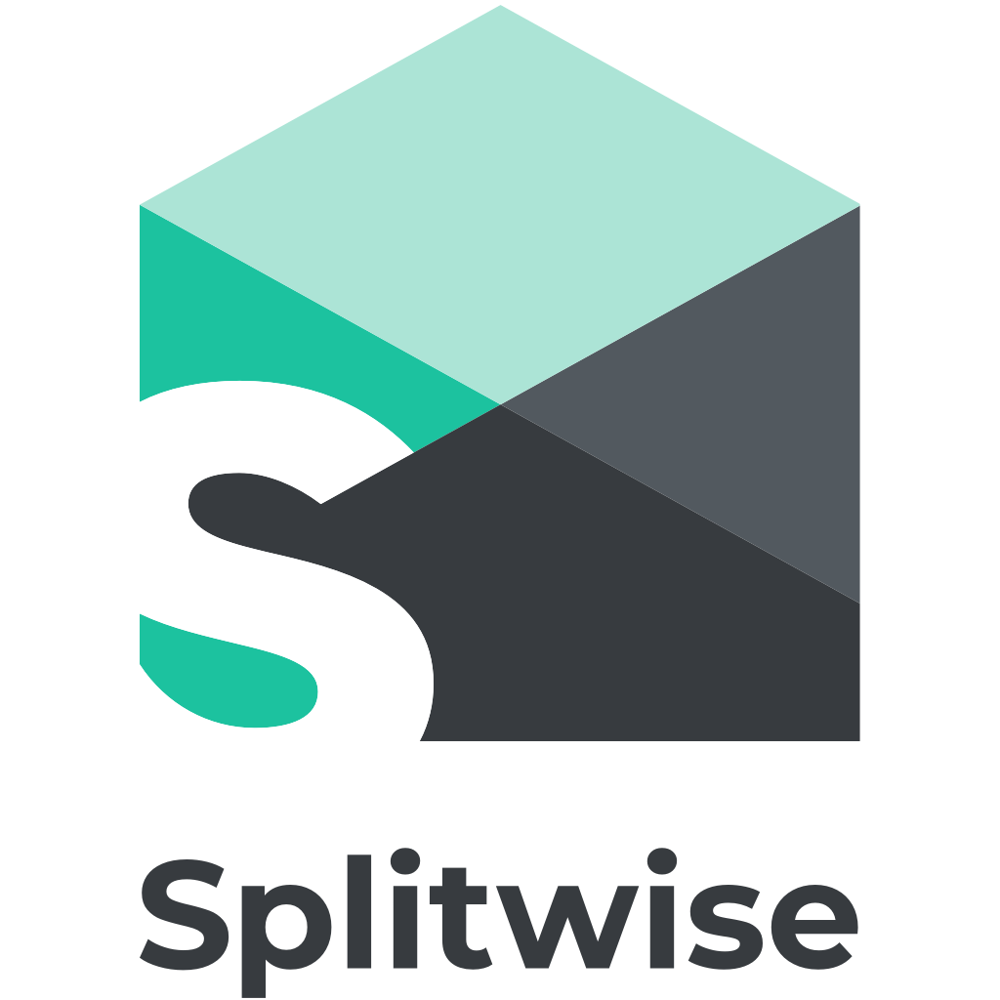

# Enro

Enro is a navigation library for Kotlin Multiplatform: Android, iOS, Desktop
and Web. In Enro, **a screen is declared like a function**.

A `NavigationKey` is the signature of a screen. The `NavigationKey` declares
the screen's inputs and, optionally, the type of the screen's result. Code that
opens a screen depends on the `NavigationKey`, not on the screen's
implementation.

<!-- snippet: basic-concepts/keys -->
```kotlin
@Serializable
data class ShowProfile(val userId: String) : NavigationKey

@Serializable
data class SelectDate(
    val minDate: LocalDate? = null,
    val maxDate: LocalDate? = null,
) : NavigationKey.WithResult<LocalDate>
```

The same two contracts, written as function signatures:

<!-- snippet: index/signatures -->
```kotlin
fun showProfile(userId: String): Unit
fun selectDate(minDate: LocalDate? = null, maxDate: LocalDate? = null): LocalDate
```

Enro destinations are Composables. On Android, a Fragment or an Activity can
also be a destination. The `enro-compat` module provides the Enro 2 API for
apps that are migrating to Enro 3.

## Getting Started

- [Installation](docs/getting-started/installation.md) — the Gradle dependencies and the install call for each platform.
- [Basic Concepts](docs/getting-started/basic-concepts.md) — a definition of each Enro term.
- [Your First Screen](docs/getting-started/your-first-screen.md) — an example with three screens, navigation between the screens, and a result.

## Core Concepts

- [Navigation Keys](docs/core-concepts/navigation-keys.md)
- [Navigation Destinations](docs/core-concepts/navigation-destinations.md)
- [Navigation Containers](docs/core-concepts/navigation-containers.md)
- [Navigation Handles](docs/core-concepts/navigation-handles.md)

## Advanced Topics

- [Results](docs/advanced/results.md)
    - [Embedded Result Flows](docs/advanced/results/embedded-result-flows.md)
    - [Managed Result Flows](docs/advanced/results/managed-result-flows.md)
    - [Flows in a ViewModel](docs/advanced/results/navigation-flows.md)
- [View Models](docs/advanced/view-models.md)
- [Animations](docs/advanced/animations.md)
- [Testing](docs/advanced/testing.md)
- [Plugins](docs/advanced/plugins.md)
- [Synthetic Destinations](docs/advanced/synthetic-destinations.md)
- [Path Bindings](docs/advanced/path-bindings.md)
- [Interceptors](docs/advanced/interceptors.md)
- [Deep Links](docs/advanced/deep-links.md)
- [Saved State](docs/advanced/saved-state.md)
- [Dependency Injection](docs/advanced/dependency-injection.md)
- [Multi-Module Projects](docs/advanced/multi-module.md)

## Platform-Specific Guides

- [Android](docs/platform/android.md)
- [iOS](docs/platform/ios.md)
- [Desktop](docs/platform/desktop.md)
- [Web](docs/platform/web.md)

## Migrating from Enro 2

Enro 3 is a rewrite of Enro 2. The [migration guide](docs/migrating-from-v2.md)
lists each API change and the steps to convert an app.

## Recipes

The recipes app contains runnable examples. Each recipe shows one concept.
[Recipes](docs/recipes.md) lists the recipes and the commands that run the
recipes app.

## Sample apps

Three larger samples each combine several features: a branching loan
application form, a recipe browser, and a travel planner with login. See
[Sample Apps](docs/samples.md).

## Troubleshooting

[Troubleshooting](docs/troubleshooting.md) lists Enro error messages and the
fix for each error.

## Applications using Enro

<p>
    <a href="https://www.splitwise.com/">
        
    </a>
    &nbsp;&nbsp;
    <a href="https://play.google.com/store/apps/details?id=com.beyondbudget">
        
    </a>
</p>

---

*"The novices' eyes followed the wriggling path up from the well as it swept a great meandering arc around the hillside. Its stones were green with moss and beset with weeds. Where the path disappeared through the gate they noticed that it joined a second track of bare earth, where the grass appeared to have been trampled so often that it ceased to grow. The dusty track ran straight from the gate to the well, marred only by a fresh set of sandal-prints that went down, and then up, and ended at the feet of the young monk who had fetched their water." — [The Garden Path](http://thecodelesscode.com/case/156)*
